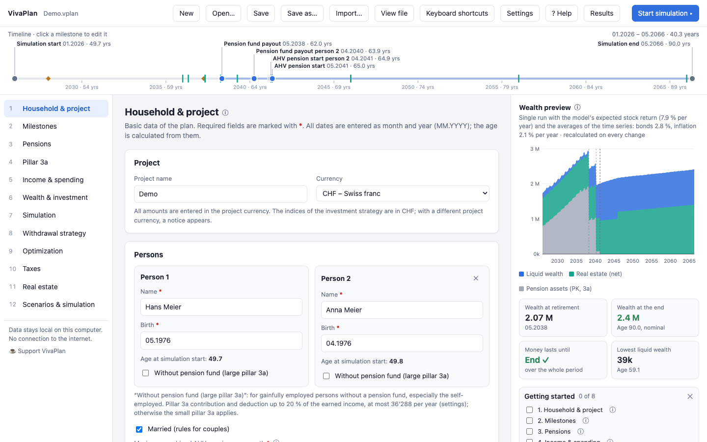

<p align="center"><a href="README.md">Deutsch</a> · <b>English</b> · <a href="README.fr.md">Français</a> · <a href="README.it.md">Italiano</a></p>

<h1 align="center">VivaPlan</h1>

<p align="center">
  <b>Will the money last – and how certain is that?</b><br>
  Retirement planning for Switzerland. Month by month, thousands of market histories, everything on your computer.
</p>

<p align="center">
  <a href="LICENSE"></a>
  
  <a href="https://github.com/ingen63/VivaPlan/actions/workflows/test-quality.yml"></a>
</p>

<p align="center">
  
</p>

https://github.com/user-attachments/assets/27a574d7-e356-415d-9bed-2230ae452f8d

<p align="center">
  ▶ <a href="https://archive.org/details/vivaplan-video-en/vivaplan-2min.mp4">VivaPlan in 2 minutes</a> ·
  ▶ <a href="https://archive.org/details/vivaplan-video-en/vivaplan-10min.mp4">VivaPlan in 10 minutes</a>
</p>

<p align="center"><sub>The screenshot and the videos show the same example plan with made-up data.</sub></p>

## What it is about

VivaPlan calculates your financial future from today until the end of the plan, with the Swiss particulars: old-age
pension (AHV), pension fund (BVG) with conversion rate and lump-sum withdrawal, pillar 3a, income tax, wealth tax,
lump-sum tax and property gains tax, SARON mortgages and the banks' affordability calculation.

Because nobody knows the stock market, VivaPlan does not calculate one path but thousands: every historical starting
month or Monte Carlo paths. The result is a clear number of how many cases the money lasts in, with the worst case
next to it.

## What VivaPlan can do

- 🧮 **Month by month:** income, pensions, taxes, real estate and mortgages in one calculation
- 📈 **120 years of market history:** World (11 countries, 1900–2020), Switzerland, S&P 500 since 1872, all in CHF
- 🎲 **Monte Carlo:** bootstrap from historical blocks or a stock model with price jumps; 50'000 paths in a few
  seconds, the same settings always give the same results
- 🪜 **Six withdrawal strategies:** Standard, 3-bucket (optionally with guardrails), fixed withdrawal rate, Guardrails
  (Guyton-Klinger), VPW, Endowment
- 🎯 **Optimization:** searches for the strategy with the highest and steadiest consumption at a limited probability of
  ruin and adopts it with one click
- 🏠 **Real estate:** purchase, sale, moving from a house to an apartment, emergency sale, property gains tax
- 👫 **Two persons:** own pension fund and AHV each, rules for married couples for AHV and taxes
- 🔀 **Scenarios:** “What if I retire at 63 and take half as a lump sum?” as curves and heat maps
- 🕰️ **What would have happened:** “How would I have fared if I had retired in 1973?”
- 🗂️ **Compare simulations:** every simulation is saved together with the plan as it was then
- ❓ **Help on F1:** for the field you are working on, plus a [manual](crates/app/ui/hilfe/en/00-einstieg.md) with search
- 🌐 **German, English, French and Italian:** user interface, menus, messages and help in all four languages
  (choose under *View → Language*); numbers always in Swiss format. The command line prints English texts.

The detailed description is in [docs/BESCHREIBUNG.md](docs/BESCHREIBUNG.md) (German).

## Your data stays with you

No account, no cloud, no tracking: VivaPlan never accesses the network. A plan is a single file (`.vplan`) that you
save, copy and archive like any other document.

## Installation

The package for macOS (.dmg) is available under [Releases](https://github.com/ingen63/VivaPlan/releases). Packages for
Windows and Linux are not available at the moment.

The package is not signed. The operating system therefore warns on the first start:

- **macOS:** Drag the app into the «Applications» folder and open it. If a message says it cannot be opened, click
  «Open Anyway» under *System Settings → Privacy & Security*.

## Getting started

1. Start VivaPlan: the welcome dialog offers the example plan, your own plan or an empty plan.
2. The checklist «Getting started» guides you through the eight steps of the quick start and ticks off what is done.
3. Start the simulation: the overview says in words how safe the plan is and suggests the next step.

> **Note:** VivaPlan is a calculation tool and not investment, tax or pension advice. Past returns are no forecast.

## Data and sources

The returns come from the Jordà-Schularick-Taylor Macrohistory Database (CC BY-NC-SA 4.0), the data of
Robert J. Shiller, the Swiss National Bank and the Federal Statistical Office. They are not covered by the license of
the program. Terms and citations are in [QUELLEN.md](crates/engine/data/QUELLEN.md) (German). Because of the JST
license, VivaPlan remains free of charge.

## Development

Rust workspace with the calculation core (`crates/engine`), the command line (`crates/cli`) and the desktop app
(Tauri 2, `crates/app`, user interface in HTML/JS without external libraries). More than 600 Rust tests, user
interface tests with Playwright, coverage of at least 80 % per package, mutation tests and fuzzing.

- Structure, building, command line, project file and calculation rules: [docs/ENTWICKLUNG.md](docs/ENTWICKLUNG.md)
  (German)
- Test strategy: [docs/TESTS.md](docs/TESTS.md) (German)

```sh
cargo build --release
target/release/vivaplan run crates/engine/assets/example.vplan --events   # output in English (#176)
make test        # all Rust tests with nextest (not cargo test; reason in docs/TESTS.md)
```

Bugs and wishes are welcome as an [issue](https://github.com/ingen63/VivaPlan/issues).

## Support

VivaPlan is free of charge. If you find the project useful, you can support it voluntarily with a coffee:
[buymeacoffee.com/vivaplan](https://buymeacoffee.com/vivaplan).

## License

Program code: [GPL v3](LICENSE). The included time series are not covered by it; the rights to the underlying data
belong to the sources (Robert J. Shiller, SNB, Federal Statistical Office, Jordà-Schularick-Taylor), see
[QUELLEN.md](crates/engine/data/QUELLEN.md).
