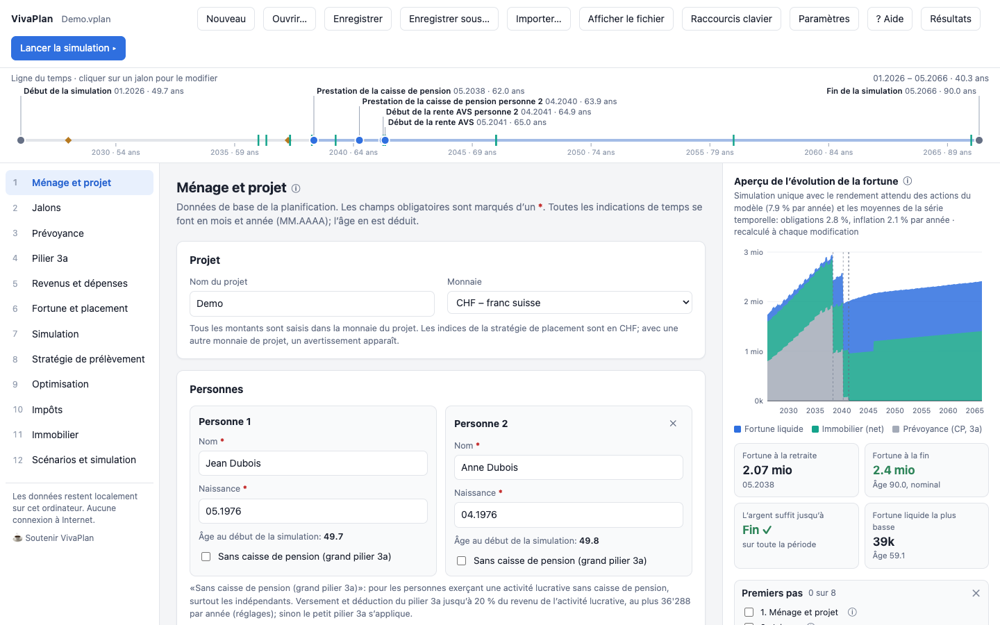

<p align="center"><a href="README.md">Deutsch</a> · <a href="README.en.md">English</a> · <b>Français</b> · <a href="README.it.md">Italiano</a></p>

<h1 align="center">VivaPlan</h1>

<p align="center">
  <b>L’argent suffira-t-il – et avec quelle sécurité?</b><br>
  Planification de la retraite pour la Suisse. Mois par mois, des milliers d’évolutions boursières, tout sur votre ordinateur.
</p>

<p align="center">
  <a href="LICENSE"></a>
  
  <a href="https://github.com/ingen63/VivaPlan/actions/workflows/test-quality.yml"></a>
</p>

<p align="center">
  
</p>

https://github.com/user-attachments/assets/e9e3b9d8-debe-462f-b199-298ddb8b8a71

<p align="center">
  ▶ <a href="https://archive.org/details/vivaplan-video-fr/vivaplan-2min.mp4">VivaPlan en 2 minutes</a> ·
  ▶ <a href="https://archive.org/details/vivaplan-video-fr/vivaplan-10min.mp4">VivaPlan en 10 minutes</a>
</p>

<p align="center"><sub>La capture d’écran et les vidéos montrent la même planification d’exemple avec des données fictives.</sub></p>

## De quoi il s’agit

VivaPlan calcule votre avenir financier d’aujourd’hui jusqu’à la fin de la planification, avec les particularités
suisses: AVS, caisse de pension avec taux de conversion et retrait en capital, pilier 3a, impôt sur le revenu, impôt
sur la fortune, impôt sur les prestations en capital et impôt sur les gains immobiliers selon le canton et la commune,
hypothèques SARON et calcul de la capacité financière des banques.

Comme personne ne connaît la bourse, VivaPlan ne calcule pas une seule évolution, mais des milliers: chaque mois de
départ historique ou des trajectoires Monte-Carlo. Au final, un chiffre clair indique dans combien de cas l’argent
suffit, avec le pire cas à côté.

Et vous n’avez pas besoin de tout saisir vous-même: **connectez VivaPlan à une IA** comme Claude, ChatGPT ou un modèle
local dans LM Studio; l’IA vous demande vos chiffres au fil de la conversation, calcule avec VivaPlan, compare des
variantes et explique les résultats ([en savoir plus](#utiliser-vivaplan-avec-une-ia)).

**L’application est 100 % locale:** elle calcule sur votre ordinateur et n’envoie rien. La connexion à une IA est
facultative et n’est pas locale: avec une IA dans le cloud, les données de votre planification sont transmises à son
fournisseur ([ce que cela signifie](#utiliser-vivaplan-avec-une-ia)).

## Ce que VivaPlan sait faire

- 🤖 **Planifier avec une IA:** l’IA ouvre, modifie, calcule et compare des planifications et explique les résultats
  en mots; configuration via *Aide → Connecter à une IA …*, pour Claude Desktop en un clic
  ([en savoir plus](#utiliser-vivaplan-avec-une-ia))
- 🧮 **Mois par mois:** revenus, prévoyance, impôts, biens immobiliers et hypothèques dans un seul calcul
- 📈 **120 ans d’histoire boursière:** monde (11 pays, 1900–2020), Suisse, S&P 500 depuis 1872, tout en CHF
- 🎲 **Monte-Carlo:** bootstrap à partir de blocs historiques ou modèle d’actions avec sauts de cours; 50'000
  trajectoires en quelques secondes, les mêmes réglages donnent toujours les mêmes résultats
- 🪜 **Six stratégies de prélèvement:** Standard, 3 compartiments (au choix avec garde-fous), taux de prélèvement fixe,
  Guardrails (Guyton-Klinger), VPW, Endowment
- 🎯 **Optimisation et comparaison:** cherche la stratégie avec la consommation la plus élevée et la plus régulière
  pour une probabilité de ruine limitée et la reprend en un clic; au choix *Comparer les stratégies (sans
  optimisation)*; les résultats de l’optimisation peuvent être enregistrés et rouverts
- 🧾 **Impôts selon le domicile:** impôt sur le revenu, sur la fortune et sur les prestations en capital selon le
  canton et la commune, impôt sur les gains immobiliers selon le canton du bien; déductions du revenu (proposition du
  canton ou lignes propres) et de la fortune, valeur fiscale par bien immobilier, un domicile qui peut changer avec le
  temps. Les impôts sont une estimation.
- 🏠 **Immobilier:** achat, vente, passage d’une maison à un appartement, vente forcée, impôt sur les gains
  immobiliers; capacité financière selon les règles des banques, adaptable dans les paramètres; option «Ne jamais
  vendre les biens immobiliers»
- 👫 **Deux personnes:** caisse de pension et AVS propres, règles pour les couples mariés pour l’AVS et les impôts;
  personnes sans caisse de pension avec grand pilier 3a
- 📐 **Valeurs dépendant du temps et courbes caractéristiques:** montants et taux restent constants ou évoluent en
  paliers, en droite, selon un tableau ou avec un facteur; les courbes caractéristiques font dépendre une valeur de
  l’état de la planification
- 🔀 **Scénarios:** «Et si je partais à 63 ans en retirant la moitié en capital?» sous forme de courbes et de cartes de
  chaleur
- 🕰️ **Ce qui se serait passé:** «Comment m’en serais-je sorti si j’avais pris ma retraite en 1973?»
- 🗂️ **Comparer des simulations:** chaque simulation est enregistrée avec la planification de l’époque
- ❓ **Aide avec F1:** pour le champ sur lequel vous travaillez, avec un [manuel](crates/app/ui/hilfe/fr/00-einstieg.md)
  et une recherche, ainsi que deux vidéos d’introduction (*Aide → Vidéos d’introduction …*)
- 🌗 **Clair ou sombre:** paramètre «Apparence» avec un thème clair et un thème sombre ou comme le système
- 🌐 **Allemand, anglais, français et italien:** interface, menus, messages et aide dans les quatre langues (choix sous
  *Affichage → Langue*); nombres toujours au format suisse. La ligne de commande `vivaplan` est fournie avec le paquet
  d’installation et affiche des textes en anglais.

La description détaillée se trouve dans [docs/BESCHREIBUNG.md](docs/BESCHREIBUNG.md) (en allemand).

## Utiliser VivaPlan avec une IA

> [!IMPORTANT]
> **Avec une IA, vos données quittent votre ordinateur.** L’application elle-même est 100 % locale, la connexion à une
> IA ne l’est pas: tout ce que l’IA lit dans votre planification (revenus, dépenses, fortune, caisse de pension,
> immeubles, résultats) fait partie de la conversation. Avec une IA dans le cloud (Claude, ChatGPT), cela est transmis
> à son fournisseur et soumis à ses règles de protection des données. Ce n’est qu’avec un modèle local (par exemple
> dans LM Studio) que tout reste sur votre ordinateur. La connexion à une IA est facultative; VivaPlan fonctionne
> entièrement sans elle.

VivaPlan est livré avec un serveur MCP (`vivaplan mcp`, Model Context Protocol). Par ce biais, une IA travaille
directement avec le noyau de calcul de VivaPlan: elle ouvre une planification, lit et modifie des valeurs, simule,
compare des variantes, reprend la meilleure et enregistre le résultat dans un nouveau fichier. Elle calcule exactement
comme l’application et explique les chiffres dans votre langue. Par exemple:

> «J’ai 58 ans et j’aimerais arrêter de travailler à 63 ans. Mon argent suffira-t-il jusqu’à 95 ans? Et qu’est-ce qui
> change si je retire la moitié de la caisse de pension en capital?»

- **Commencer avec vos propres chiffres:** si vous n’avez pas encore de planification, l’IA commence avec une
  planification vide (comme *Fichier → Nouvelle planification*), vous demande les indications manquantes (revenus,
  dépenses, fortune, caisse de pension, AVS et ce qui en fait partie) et n’invente aucune valeur. La planification
  d’exemple sert uniquement à essayer et à faire des démonstrations.
- **Programmes d’IA pris en charge:** Claude Desktop, Claude Code, l’application de bureau ChatGPT et LM Studio;
  d’autres programmes compatibles MCP se connectent de la même manière.
- **Configuration:** le menu *Aide → Connecter à une IA …* indique pour chaque programme d’IA où placer l’entrée et
  propose une ligne toute prête, avec le chemin du programme sur votre ordinateur, à copier. VivaPlan ne configure rien
  lui-même. Pour Claude Desktop sous macOS, le paquet en un clic `VivaPlan_<version>_aarch64.mcpb` se trouve sur la
  [page des versions](https://github.com/ingen63/VivaPlan/releases): un double-clic, et Claude Desktop installe
  VivaPlan comme extension.
- **Dossier des planifications et «Lecture seule»:** lors de la configuration, vous choisissez un dossier des
  planifications (le `.mcpb` le demande à l’installation). L’IA n’ouvre et n’enregistre des planifications que dans ce
  dossier et ses sous-dossiers. Avec l’option «Lecture seule», elle peut ouvrir, modifier et calculer des
  planifications, mais pas les enregistrer. L’enregistrement crée de toute façon un nouveau fichier; l’IA ne remplace
  un fichier existant qu’après vous avoir demandé et avec une copie de sauvegarde.
- **Ce qu’il advient de vos données:** voir la remarque ci-dessus. Le serveur remplace les noms par des noms neutres
  («Person 1»), les réponses ne citent que le nom du fichier; l’IA voit toutefois tous les montants en entier.
  VivaPlan lui-même n’envoie rien; c’est le programme d’IA qui transmet la conversation.

Tout le reste se trouve dans l’aide sous «Connecter des programmes d’IA»
([référence](crates/app/ui/hilfe/fr/60-referenz.md)). Les résultats sont des calculs de modèle sans garantie, même
lorsqu’une IA les explique.

## Vos données restent chez vous

L’application est 100 % locale. Pas de compte, pas de cloud, pas de suivi: VivaPlan n’accède jamais au réseau, ni
l’application, ni le noyau de calcul, ni le serveur MCP `vivaplan mcp`.

La seule exception est une IA que vous connectez vous-même: avec une IA dans le cloud, les données de planification
que l’IA lit sont transmises à son fournisseur; ce n’est qu’avec un modèle local qu’elles restent sur votre ordinateur
([en savoir plus](#utiliser-vivaplan-avec-une-ia)).

Une planification est un seul fichier (`.vplan`) que vous enregistrez, copiez et archivez comme tout autre
document.

## Installation

Les paquets de chaque version se trouvent sur la [page des versions](https://github.com/ingen63/VivaPlan/releases):

| Système | Paquet |
|---|---|
| macOS (puce Apple) | `.dmg` |
| Windows | `.msi` ou `-setup.exe` |
| Linux | `.deb` ou `.AppImage` (`.rpm` uniquement pour les versions sans «beta») |
| Claude Desktop sous macOS | `.mcpb`, le paquet en un clic pour la connexion à une IA |

Les paquets ne sont pas signés. Au premier démarrage, le système d’exploitation affiche donc un avertissement:

- **macOS:** glisser l’app dans le dossier «Applications» et l’ouvrir. Si un message indique qu’elle ne peut pas être
  ouverte, cliquer sur «Ouvrir quand même» sous *Réglages Système → Confidentialité et sécurité*.
- **Windows:** dans la fenêtre bleue «Windows a protégé votre ordinateur», cliquer sur «Informations complémentaires»,
  puis sur «Exécuter quand même».
- **Linux:** rendre le fichier AppImage exécutable (`chmod +x VivaPlan*.AppImage`) ou installer le paquet .deb.

Claude Desktop avertit aussi lors de l’installation du `.mcpb` que l’extension obtient l’accès à tout l’ordinateur.
Claude Desktop l’affiche pour chaque extension; VivaPlan applique lui-même la limite au dossier des planifications.

**Jeton bêta (bêta fermée):** au premier démarrage, l’app demande votre jeton bêta personnel, une ligne commençant par
`VP1.beta.`. L’activation vaut ensuite durablement pour cet ordinateur, même après les mises à jour. La date du jeton
est un délai d’utilisation: il ne peut être saisi que jusque-là; une installation activée continue ensuite de
fonctionner. Si l’app est activée, le `.mcpb` n’a pas besoin de jeton; sinon, saisissez-le dans le champ «Beta token»
lors de l’installation dans Claude Desktop. La vérification a lieu sur votre ordinateur, sans Internet. À partir de
la version 1.0.0, aucun jeton n’est plus nécessaire.

## Premiers pas

1. Démarrer VivaPlan: le dialogue de bienvenue propose la planification d’exemple, une planification propre ou une
   planification vide.
2. La liste de contrôle «Premiers pas» guide à travers les huit étapes du démarrage rapide et coche elle-même ce qui
   est fait.
3. Lancer la simulation: la vue d’ensemble dit en mots à quel point le plan est sûr et propose l’étape suivante.

Ou laissez-vous guider par une IA: configurez-la avec *Aide → Connecter à une IA …* et demandez dans le programme d’IA
si votre argent suffira.

> **Remarque:** VivaPlan est un outil de calcul et non un conseil en placement, en impôts ou en prévoyance. Les
> rendements passés ne sont pas une prévision.

## Données et sources

Les rendements proviennent de la Jordà-Schularick-Taylor Macrohistory Database (CC BY-NC-SA 4.0), des données de
Robert J. Shiller, de la Banque nationale suisse et de l’Office fédéral de la statistique. Ils ne relèvent pas de la
licence du programme. Les conditions et les citations figurent dans [QUELLEN.md](crates/engine/data/QUELLEN.md) (en
allemand). En raison de la licence JST, VivaPlan reste gratuit.

## Développement

Workspace Rust avec le noyau de calcul (`crates/engine`), la ligne de commande (`crates/cli`) et l’application de
bureau (Tauri 2, `crates/app`, interface en HTML/JS sans bibliothèques externes). Plus de 600 tests Rust, tests de
l’interface avec Playwright, couverture d’au moins 80 % par paquet, tests de mutation et fuzzing.

- Structure, compilation, ligne de commande, fichier de projet et règles de calcul:
  [docs/ENTWICKLUNG.md](docs/ENTWICKLUNG.md) (en allemand)
- Stratégie de test: [docs/TESTS.md](docs/TESTS.md) (en allemand)

```sh
cargo build --release
target/release/vivaplan run crates/engine/assets/example.vplan --events   # sortie en anglais (#176)
make test        # tous les tests Rust avec nextest (pas cargo test; raison dans docs/TESTS.md)
```

Erreurs et souhaits volontiers sous forme d’[issue](https://github.com/ingen63/VivaPlan/issues).

## Soutenir

VivaPlan est gratuit. Si vous trouvez le projet utile, vous pouvez le soutenir librement avec un café:
[buymeacoffee.com/vivaplan](https://buymeacoffee.com/vivaplan).

## Licence

Code du programme: [GPL v3](LICENSE). Les séries temporelles fournies n’en relèvent pas; les droits sur les données de
base appartiennent aux sources (Robert J. Shiller, BNS, Office fédéral de la statistique, Jordà-Schularick-Taylor),
voir [QUELLEN.md](crates/engine/data/QUELLEN.md).
