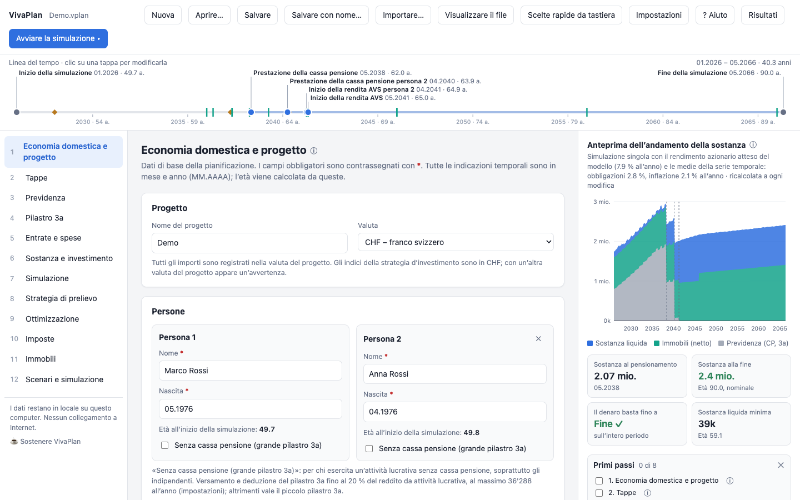

<p align="center"><a href="README.md">Deutsch</a> · <a href="README.en.md">English</a> · <a href="README.fr.md">Français</a> · <b>Italiano</b></p>

<h1 align="center">VivaPlan</h1>

<p align="center">
  <b>Il denaro basterà – e con quale sicurezza?</b><br>
  Pianificazione della previdenza per la Svizzera. Mese per mese, migliaia di andamenti di borsa, tutto sul Suo computer.
</p>

<p align="center">
  <a href="LICENSE"></a>
  
  <a href="https://github.com/ingen63/VivaPlan/actions/workflows/test-quality.yml"></a>
</p>

<p align="center">
  
</p>

https://github.com/user-attachments/assets/a36a4b34-f958-4ac2-89be-6eb055769b93

<p align="center">
  ▶ <a href="https://archive.org/details/vivaplan-video-it/vivaplan-2min.mp4">VivaPlan in 2 minuti</a> ·
  ▶ <a href="https://archive.org/details/vivaplan-video-it/vivaplan-10min.mp4">VivaPlan in 10 minuti</a>
</p>

<p align="center"><sub>Lo screenshot e i video mostrano la stessa pianificazione d’esempio con dati inventati.</sub></p>

## Di che cosa si tratta

VivaPlan calcola il Suo futuro finanziario da oggi fino alla fine della pianificazione, con le particolarità svizzere:
AVS, cassa pensione con aliquota di conversione e prelievo del capitale, pilastro 3a, imposta sul reddito, imposta
sulla sostanza, imposta sulle prestazioni in capitale e imposta sugli utili immobiliari secondo cantone e comune,
ipoteche SARON e calcolo della sostenibilità delle banche.

Poiché nessuno conosce la borsa, VivaPlan non calcola un solo andamento, ma migliaia: ogni mese di partenza storico
oppure percorsi Monte Carlo. Alla fine c’è un numero chiaro che indica in quanti casi il denaro basta, con accanto il
caso peggiore.

E non deve inserire tutto da solo: **colleghi VivaPlan a un’IA** come Claude, ChatGPT o un modello locale in
LM Studio; l’IA Le chiede i Suoi dati nel corso della conversazione, calcola con VivaPlan, confronta varianti e spiega
i risultati ([maggiori informazioni](#usare-vivaplan-con-un-programma-di-ia)).

**L’applicazione è locale al 100 %:** calcola sul Suo computer e non invia nulla. Il collegamento a un’IA è facoltativo
e non è locale: con un’IA nel cloud i dati della Sua pianificazione vanno al suo fornitore
([che cosa significa](#usare-vivaplan-con-un-programma-di-ia)).

## Che cosa sa fare VivaPlan

- 🤖 **Pianificare con un’IA:** l’IA apre, modifica, calcola e confronta pianificazioni e spiega i risultati a parole;
  configurazione tramite *Aiuto → Collegare a un’IA …*, per Claude Desktop con un clic
  ([maggiori informazioni](#usare-vivaplan-con-un-programma-di-ia))
- 🧮 **Mese per mese:** redditi, previdenza, imposte, immobili e ipoteche in un unico calcolo
- 📈 **120 anni di storia della borsa:** mondo (11 paesi, 1900–2020), Svizzera, S&P 500 dal 1872, tutto in CHF
- 🎲 **Monte Carlo:** bootstrap da blocchi storici oppure un modello azionario con salti di corso; 50'000 percorsi in
  pochi secondi, le stesse impostazioni danno sempre gli stessi risultati
- 🪜 **Sei strategie di prelievo:** Standard, 3 comparti (a scelta con guardrail), tasso di prelievo fisso, Guardrails
  (Guyton-Klinger), VPW, Endowment
- 🎯 **Ottimizzazione e confronto:** cerca la strategia con il consumo più alto e più regolare con una probabilità di
  rovina limitata e la riprende con un clic; a scelta *Confrontare le strategie (senza ottimizzazione)*; i risultati
  dell’ottimizzazione si possono salvare e riaprire
- 🧾 **Imposte secondo il domicilio:** imposta sul reddito, sulla sostanza e sulle prestazioni in capitale secondo
  cantone e comune, imposta sugli utili immobiliari secondo il cantone dell’immobile; deduzioni dal reddito (proposta
  del cantone o righe proprie) e dalla sostanza, valore fiscale per immobile, un domicilio che può cambiare nel tempo.
  Le imposte sono una stima.
- 🏠 **Immobili:** acquisto, vendita, passaggio da una casa a un appartamento, vendita forzata, imposta sugli utili
  immobiliari; sostenibilità secondo le regole delle banche, adattabile nelle impostazioni; opzione «Non vendere mai gli
  immobili»
- 👫 **Due persone:** cassa pensione e AVS proprie, regole per i coniugi per l’AVS e le imposte; persone senza cassa
  pensione con grande pilastro 3a
- 📐 **Valori dipendenti dal tempo e curve caratteristiche:** importi e aliquote restano costanti o evolvono a gradini,
  in retta, secondo una tabella o con un fattore; le curve caratteristiche fanno dipendere un valore dallo stato della
  pianificazione
- 🔀 **Scenari:** «E se andassi in pensione a 63 anni prelevando metà come capitale?» come curve e mappe di calore
- 🕰️ **Che cosa sarebbe successo:** «Come mi sarebbe andata se fossi andato in pensione nel 1973?»
- 🗂️ **Confrontare simulazioni:** ogni simulazione viene salvata con la pianificazione di allora
- ❓ **Aiuto con F1:** per il campo su cui sta lavorando, con un [manuale](crates/app/ui/hilfe/it/00-einstieg.md) e una
  ricerca, oltre a due video introduttivi (*Aiuto → Video introduttivi …*)
- 🌗 **Chiaro o scuro:** impostazione «Aspetto» con un tema chiaro e uno scuro o come il sistema
- 🌐 **Tedesco, inglese, francese e italiano:** interfaccia, menu, messaggi e aiuto in tutte e quattro le lingue
  (scelta in *Vista → Lingua*); numeri sempre nel formato svizzero. La riga di comando `vivaplan` è inclusa nel
  pacchetto d’installazione ed emette testi in inglese.

La descrizione dettagliata si trova in [docs/BESCHREIBUNG.md](docs/BESCHREIBUNG.md) (in tedesco).

## Usare VivaPlan con un programma di IA

> [!IMPORTANT]
> **Con un’IA i Suoi dati lasciano il computer.** L’applicazione stessa è locale al 100 %, il collegamento a un’IA no:
> tutto ciò che l’IA legge dalla Sua pianificazione (reddito, spese, patrimonio, cassa pensioni, immobili, risultati)
> diventa parte della conversazione. Con un’IA nel cloud (Claude, ChatGPT) va al suo fornitore ed è soggetto alle sue
> norme sulla protezione dei dati. Solo con un modello locale (per esempio in LM Studio) tutto resta sul Suo computer.
> Il collegamento a un’IA è facoltativo; VivaPlan funziona completamente anche senza.

VivaPlan include un server MCP (`vivaplan mcp`, Model Context Protocol). Tramite questo, un’IA lavora direttamente con
il nucleo di calcolo di VivaPlan: apre una pianificazione, legge e modifica valori, simula, confronta varianti, riprende
la migliore e salva il risultato in un nuovo file. Calcola esattamente come l’applicazione e spiega le cifre nella Sua
lingua. Per esempio:

> «Ho 58 anni e vorrei smettere di lavorare a 63. Il mio denaro basterà fino a 95 anni? E che cosa cambia se prelevo
> metà della cassa pensione come capitale?»

- **Iniziare con i propri dati:** se non ha ancora una pianificazione, l’IA inizia con una pianificazione vuota (come
  *File → Nuova pianificazione*), Le chiede le indicazioni mancanti (redditi, spese, sostanza, cassa pensione, AVS e
  quanto altro occorre) e non inventa valori. La pianificazione d’esempio serve solo per provare e per dimostrazioni.
- **Programmi di IA supportati:** Claude Desktop, Claude Code, l’app desktop di ChatGPT e LM Studio; altri programmi
  compatibili con MCP si collegano allo stesso modo.
- **Configurazione:** il menu *Aiuto → Collegare a un’IA …* indica per ogni programma di IA dove va la voce e propone
  una riga pronta, con il percorso del programma sul Suo computer, da copiare. VivaPlan non configura nulla da sé. Per
  Claude Desktop su macOS c’è il pacchetto con un clic `VivaPlan_<versione>_aarch64.mcpb` sulla
  [pagina delle versioni](https://github.com/ingen63/VivaPlan/releases): un doppio clic e Claude Desktop installa
  VivaPlan come estensione.
- **Cartella delle pianificazioni e «Sola lettura»:** durante la configurazione sceglie una cartella delle
  pianificazioni (il `.mcpb` la chiede durante l’installazione). L’IA apre e salva pianificazioni solo in questa
  cartella e nelle sue sottocartelle. Con l’opzione «Sola lettura» può aprire, modificare e calcolare pianificazioni,
  ma non salvarle. Il salvataggio crea comunque un nuovo file; l’IA sostituisce un file esistente solo dopo averglielo
  chiesto e con una copia di sicurezza.
- **Che cosa succede ai Suoi dati:** vedere l’avviso sopra. Il server sostituisce i nomi con nomi neutri
  («Person 1»), le risposte citano solo il nome del file; l’IA vede però tutti gli importi per intero. VivaPlan stesso
  non invia nulla; è il programma di IA a trasmettere la conversazione.

Tutto il resto si trova nell’aiuto alla voce «Collegare programmi di IA»
([riferimento](crates/app/ui/hilfe/it/60-referenz.md)). I risultati sono calcoli di modello senza garanzia, anche
quando è un’IA a spiegarli.

## I Suoi dati restano con Lei

L’applicazione è locale al 100 %. Nessun account, nessun cloud, nessun tracciamento: VivaPlan non accede mai alla
rete, né l’applicazione, né il nucleo di calcolo, né il server MCP `vivaplan mcp`.

L’unica eccezione è un’IA che Lei stesso collega: con un’IA nel cloud i dati della pianificazione che l’IA legge vanno
al suo fornitore; solo con un modello locale restano sul Suo computer
([maggiori informazioni](#usare-vivaplan-con-un-programma-di-ia)).

Una pianificazione è un unico file (`.vplan`) che Lei salva, copia e archivia come qualsiasi altro documento.

## Installazione

I pacchetti di ogni versione si trovano sulla [pagina delle versioni](https://github.com/ingen63/VivaPlan/releases):

| Sistema | Pacchetto |
|---|---|
| macOS (chip Apple) | `.dmg` |
| Windows | `.msi` o `-setup.exe` |
| Linux | `.deb` o `.AppImage` (`.rpm` solo per versioni senza «beta») |
| Claude Desktop su macOS | `.mcpb`, il pacchetto con un clic per il collegamento a un’IA |

I pacchetti non sono firmati. Al primo avvio il sistema operativo mostra quindi un avviso:

- **macOS:** trascinare l’app nella cartella «Applicazioni» e aprirla. Se appare il messaggio che non può essere
  aperta, fare clic su «Apri comunque» in *Impostazioni di Sistema → Privacy e sicurezza*.
- **Windows:** nella finestra blu «PC protetto da Windows» fare clic su «Ulteriori informazioni» e poi su «Esegui
  comunque».
- **Linux:** rendere eseguibile il file AppImage (`chmod +x VivaPlan*.AppImage`) oppure installare il pacchetto .deb.

Anche Claude Desktop avvisa durante l’installazione del `.mcpb` che l’estensione ottiene accesso a tutto il computer.
Claude Desktop lo mostra per ogni estensione; il limite alla cartella delle pianificazioni lo impone VivaPlan stesso.

**Token beta (beta chiusa):** al primo avvio l’app chiede il token beta personale, una riga che inizia con
`VP1.beta.`. L’attivazione vale poi in modo permanente per questo computer, anche dopo gli aggiornamenti. La data nel
token è un termine di riscatto: solo fino ad allora può essere inserito; un’installazione attivata continua a
funzionare anche dopo. Se l’app è attivata, il `.mcpb` non ha bisogno di un token; altrimenti inserirlo nel campo
«Beta token» durante l’installazione in Claude Desktop. La verifica avviene sul computer, senza Internet. Dalla
versione 1.0.0 non serve più alcun token.

## Primi passi

1. Avviare VivaPlan: il dialogo di benvenuto propone la pianificazione d’esempio, una pianificazione propria o una
   pianificazione vuota.
2. La lista di controllo «Primi passi» guida attraverso gli otto passi dell’avvio rapido e spunta da sola ciò che è
   fatto.
3. Avviare la simulazione: la panoramica dice a parole quanto è sicuro il piano e propone il passo successivo.

Oppure si faccia guidare da un’IA: la configuri con *Aiuto → Collegare a un’IA …* e chieda nel programma di IA se il
Suo denaro basterà.

> **Nota:** VivaPlan è uno strumento di calcolo e non una consulenza in materia di investimenti, imposte o previdenza.
> I rendimenti passati non sono una previsione.

## Dati e fonti

I rendimenti provengono dalla Jordà-Schularick-Taylor Macrohistory Database (CC BY-NC-SA 4.0), dai dati di
Robert J. Shiller, della Banca nazionale svizzera e dell’Ufficio federale di statistica. Non rientrano nella licenza
del programma. Condizioni e citazioni si trovano in [QUELLEN.md](crates/engine/data/QUELLEN.md) (in tedesco). A causa
della licenza JST, VivaPlan resta gratuito.

## Sviluppo

Workspace Rust con il nucleo di calcolo (`crates/engine`), la riga di comando (`crates/cli`) e l’applicazione desktop
(Tauri 2, `crates/app`, interfaccia in HTML/JS senza librerie esterne). Oltre 600 test Rust, test dell’interfaccia con
Playwright, copertura di almeno l’80 % per pacchetto, test di mutazione e fuzzing.

- Struttura, compilazione, riga di comando, file di progetto e regole di calcolo:
  [docs/ENTWICKLUNG.md](docs/ENTWICKLUNG.md) (in tedesco)
- Strategia di test: [docs/TESTS.md](docs/TESTS.md) (in tedesco)

```sh
cargo build --release
target/release/vivaplan run crates/engine/assets/example.vplan --events   # output in inglese (#176)
make test        # tutti i test Rust con nextest (non cargo test; motivo in docs/TESTS.md)
```

Errori e desideri sono benvenuti come [issue](https://github.com/ingen63/VivaPlan/issues).

## Sostenere

VivaPlan è gratuito. Se trova utile il progetto, può sostenerlo liberamente con un caffè:
[buymeacoffee.com/vivaplan](https://buymeacoffee.com/vivaplan).

## Licenza

Codice del programma: [GPL v3](LICENSE). Le serie temporali fornite non vi rientrano; i diritti sui dati di base
appartengono alle fonti (Robert J. Shiller, BNS, Ufficio federale di statistica, Jordà-Schularick-Taylor), vedi
[QUELLEN.md](crates/engine/data/QUELLEN.md).
