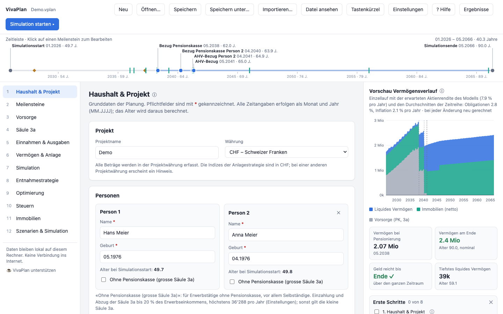

<p align="center"><b>Deutsch</b> · <a href="README.en.md">English</a> · <a href="README.fr.md">Français</a> · <a href="README.it.md">Italiano</a></p>

<h1 align="center">VivaPlan</h1>

<p align="center">
  <b>Reicht das Geld – und wie sicher ist das?</b><br>
  Pensionsplanung für die Schweiz. Monat für Monat, tausende Börsenverläufe, alles auf Ihrem Rechner.
</p>

<p align="center">
  <a href="LICENSE"></a>
  
  <a href="https://github.com/ingen63/VivaPlan/actions/workflows/test-quality.yml"></a>
</p>

<p align="center">
  
</p>

https://github.com/user-attachments/assets/d5e55050-891c-4345-a27d-df911424cc30

<p align="center">
  ▶ <a href="https://archive.org/details/vivaplan-video-de/vivaplan-2min.mp4">VivaPlan in 2 Minuten</a> ·
  ▶ <a href="https://archive.org/details/vivaplan-video-de/vivaplan-10min.mp4">VivaPlan in 10 Minuten</a>
</p>

<p align="center"><sub>Bildschirmfoto und Videos zeigen dieselbe Beispielplanung mit erfundenen Daten.</sub></p>

## Worum es geht

VivaPlan rechnet Ihre finanzielle Zukunft vom heutigen Tag bis zum Ende der Planung durch, mit den Schweizer
Eigenheiten: AHV, Pensionskasse mit Umwandlungssatz und Kapitalbezug, Säule 3a, Einkommens-, Vermögens-,
Kapitalbezugs- und Grundstückgewinnsteuer nach Kanton und Gemeinde, SARON-Hypotheken und die Tragbarkeitsrechnung der
Banken.

Weil niemand die Börse kennt, rechnet VivaPlan nicht einen Verlauf, sondern tausende: jeden historischen Startmonat
oder Monte-Carlo-Pfade. Am Ende steht eine klare Zahl, in wie vielen Fällen das Geld reicht, und der schlechteste
Fall daneben.

Und Sie müssen nicht alles selbst eintippen: **Verbinden Sie VivaPlan mit einer KI** wie Claude, ChatGPT oder einem
lokalen Modell in LM Studio, erfragt die KI Ihre Zahlen im Gespräch, rechnet mit VivaPlan, vergleicht Varianten und
erklärt die Ergebnisse ([mehr dazu](#vivaplan-mit-einer-ki-nutzen)).

**Die App ist zu 100 % lokal:** Sie rechnet auf Ihrem Rechner und sendet nichts. Die KI-Anbindung ist freiwillig und
nicht lokal: Mit einer Cloud-KI gehen Ihre Planungsdaten an deren Anbieter
([was das heisst](#vivaplan-mit-einer-ki-nutzen)).

## Was VivaPlan kann

- 🤖 **Mit einer KI planen:** Die KI öffnet, ändert, rechnet und vergleicht Planungen und erklärt die Ergebnisse in
  Worten; Einrichtung über *Hilfe → Mit KI verbinden …*, für Claude Desktop mit einem Klick
  ([mehr dazu](#vivaplan-mit-einer-ki-nutzen))
- 🧮 **Monat für Monat:** Einkommen, Vorsorge, Steuern, Immobilien und Hypotheken in einer Rechnung
- 📈 **120 Jahre Börsengeschichte:** Welt (11 Länder, 1900–2020), Schweiz, S&P 500 seit 1872, alles in CHF
- 🎲 **Monte Carlo:** Bootstrap aus historischen Blöcken oder ein Aktienmodell mit Kurssprüngen; 50 000 Pfade in
  wenigen Sekunden, gleiche Einstellungen ergeben immer gleiche Ergebnisse
- 🪜 **Sechs Entnahmestrategien:** Standard, 3-Topf (wahlweise mit Guardrails), fixe Entnahmerate, Guardrails
  (Guyton-Klinger), VPW, Endowment
- 🎯 **Optimierung und Vergleich:** sucht die Strategie mit dem höchsten und gleichmässigsten Konsum bei begrenztem
  Ruinrisiko und übernimmt sie mit einem Klick; auf Wunsch *Strategien vergleichen (ohne Optimierung)*; Ergebnisse
  der Optimierung lassen sich speichern und wieder öffnen
- 🧾 **Steuern nach Wohnort:** Einkommens-, Vermögens- und Kapitalbezugssteuer nach Kanton und Gemeinde, die
  Grundstückgewinnsteuer nach dem Kanton der Immobilie; Abzüge vom Einkommen (Vorschlag des Kantons oder eigene
  Zeilen) und vom Vermögen, Steuerwert je Liegenschaft, ein Wohnort, der mit der Zeit wechseln kann. Die Steuern sind
  eine Schätzung.
- 🏠 **Immobilien:** Kauf, Verkauf, Wechsel vom Haus in eine Wohnung, Notverkauf, Grundstückgewinnsteuer; Tragbarkeit
  nach den Regeln der Banken, anpassbar in den Einstellungen; Schalter «Immobilien nie verkaufen»
- 👫 **Zwei Personen:** eigene Pensionskasse und AHV, Ehepaar-Regeln bei AHV und Steuern; Personen ohne Pensionskasse
  mit grosser Säule 3a
- 📐 **Zeitabhängige Werte und Kennlinien:** Beträge und Sätze bleiben konstant oder verlaufen als Treppe, Gerade,
  Tabelle oder mit Faktor; Kennlinien machen einen Wert vom Zustand der Planung abhängig
- 🔀 **Szenarien:** «Was, wenn ich mit 63 gehe und die Hälfte als Kapital beziehe?» als Kurven und Heatmaps
- 🕰️ **Was wäre gewesen:** «Wie wäre es mir ergangen, wenn ich 1973 pensioniert worden wäre?»
- 🗂️ **Simulationen vergleichen:** jede Simulation wird mit der Planung von damals gespeichert
- ❓ **Hilfe auf F1:** zum Feld, an dem Sie gerade arbeiten, dazu ein [Handbuch](crates/app/ui/hilfe/de/00-einstieg.md)
  mit Suche und zwei Einführungsvideos (*Hilfe → Einführungsvideos …*)
- 🌗 **Hell oder dunkel:** Einstellung «Darstellung» mit hellem und dunklem Theme oder wie das System
- 🌐 **Deutsch, Englisch, Französisch und Italienisch:** Oberfläche, Menüs, Meldungen und Hilfe in allen vier Sprachen
  (Wahl unter *Ansicht → Sprache*); Zahlen immer im Schweizer Format. Die Kommandozeile `vivaplan` liegt dem
  Installationspaket bei und gibt englische Texte aus.

Die ausführliche Beschreibung steht in [docs/BESCHREIBUNG.md](docs/BESCHREIBUNG.md).

## VivaPlan mit einer KI nutzen

> [!IMPORTANT]
> **Mit einer KI verlassen Ihre Daten den Rechner.** Die App selbst ist zu 100 % lokal, die KI-Anbindung nicht: Alles,
> was die KI aus Ihrer Planung liest (Einkommen, Ausgaben, Vermögen, Pensionskasse, Liegenschaften, Ergebnisse), wird
> Teil des Gesprächs. Mit einer Cloud-KI (Claude, ChatGPT) geht es an deren Anbieter und unterliegt dessen
> Datenschutzbestimmungen. Nur mit einem lokalen Modell (zum Beispiel in LM Studio) bleibt alles auf Ihrem Rechner.
> Die KI-Anbindung ist freiwillig; ohne sie funktioniert VivaPlan vollständig.

VivaPlan bringt einen MCP-Server mit (`vivaplan mcp`, Model Context Protocol). Darüber arbeitet eine KI direkt mit
dem Rechenkern von VivaPlan: Sie öffnet eine Planung, liest und ändert Werte, simuliert, vergleicht Varianten,
übernimmt die beste und speichert das Ergebnis als neue Datei. Sie rechnet dabei genau wie die App und erklärt die
Zahlen in Ihrer Sprache. Zum Beispiel:

> «Ich bin 58 und möchte mit 63 aufhören. Reicht mein Geld bis 95? Und was ändert sich, wenn ich die Hälfte der
> Pensionskasse als Kapital beziehe?»

- **Mit eigenen Zahlen beginnen:** Haben Sie noch keine Planung, beginnt die KI mit einer leeren Planung (wie
  *Datei → Neue Planung*), fragt Sie nach den fehlenden Angaben (Einkommen, Ausgaben, Vermögen, Pensionskasse, AHV und
  was sonst dazugehört) und erfindet keine Werte. Die Beispielplanung dient nur zum Ausprobieren und Vorführen.
- **Unterstützte KI-Programme:** Claude Desktop, Claude Code, die ChatGPT-Desktop-App und LM Studio; andere Programme
  mit MCP lassen sich ebenso anbinden.
- **Einrichten:** Das Menü *Hilfe → Mit KI verbinden …* zeigt je KI-Programm, wohin der Eintrag gehört, und eine
  fertige Zeile mit dem Pfad des Programms auf Ihrem Rechner zum Kopieren. VivaPlan richtet nichts selbst ein. Für
  Claude Desktop unter macOS gibt es das Ein-Klick-Paket `VivaPlan_<Version>_aarch64.mcpb` auf der
  [Release-Seite](https://github.com/ingen63/VivaPlan/releases): Doppelklick, und Claude Desktop installiert VivaPlan
  als Erweiterung.
- **Planordner und «Nur lesen»:** Beim Einrichten wählen Sie einen Planordner (das `.mcpb` fragt beim Installieren
  danach). Die KI öffnet und speichert Planungen nur in diesem Ordner und seinen Unterordnern. Mit dem Schalter «Nur
  lesen» kann sie Planungen öffnen, ändern und rechnen, aber nicht speichern. Gespeichert wird ohnehin als neue Datei;
  eine vorhandene ersetzt die KI nur nach Ihrer Rückfrage und mit Sicherungskopie.
- **Was mit Ihren Daten geschieht:** Siehe den Hinweis oben. Namen ersetzt der Server durch neutrale («Person 1»),
  Antworten nennen nur den Dateinamen; alle Beträge sieht die KI aber vollständig. VivaPlan selbst sendet nichts, das
  KI-Programm schickt das Gespräch weiter.

Alles Weitere steht in der Hilfe unter «KI-Programme verbinden» ([Referenz](crates/app/ui/hilfe/de/60-referenz.md)).
Die Ergebnisse sind Modellrechnungen ohne Gewähr, auch wenn eine KI sie erklärt.

## Ihre Daten bleiben bei Ihnen

Die App ist zu 100 % lokal. Kein Konto, keine Cloud, kein Tracking: VivaPlan greift nie aufs Netzwerk zu, weder die
App noch der Rechenkern noch der MCP-Server `vivaplan mcp`.

Die einzige Ausnahme ist eine KI, die Sie selbst anbinden: Mit einer Cloud-KI gehen die Planungsdaten, die die KI
liest, an deren Anbieter; nur mit einem lokalen Modell bleiben sie auf Ihrem Rechner
([mehr dazu](#vivaplan-mit-einer-ki-nutzen)).

Eine Planung ist eine
einzelne Datei (`.vplan`), die Sie speichern, kopieren und archivieren wie jedes andere Dokument.

## Installation

Die Pakete jeder Version stehen auf der [Release-Seite](https://github.com/ingen63/VivaPlan/releases):

| System | Paket |
|---|---|
| macOS (Apple-Chip) | `.dmg` |
| Windows | `.msi` oder `-setup.exe` |
| Linux | `.deb` oder `.AppImage` (`.rpm` nur bei Versionen ohne «beta») |
| Claude Desktop unter macOS | `.mcpb`, das Ein-Klick-Paket für die KI-Anbindung |

Die Pakete sind nicht signiert. Beim ersten Start warnt das Betriebssystem deshalb:

- **macOS:** Die App in den Ordner «Programme» ziehen und öffnen. Erscheint die Meldung, dass sie nicht geöffnet werden
  kann, unter *Systemeinstellungen → Datenschutz & Sicherheit* auf «Dennoch öffnen» klicken.
- **Windows:** Im blauen Fenster «Der Computer wurde durch Windows geschützt» auf «Weitere Informationen» und dann
  «Trotzdem ausführen» klicken.
- **Linux:** Die AppImage-Datei ausführbar machen (`chmod +x VivaPlan*.AppImage`) oder das .deb-Paket installieren.

Auch Claude Desktop warnt beim Installieren des `.mcpb`, die Erweiterung erhalte Zugriff auf alles auf dem Computer. Das
zeigt Claude Desktop bei jeder Erweiterung; die Begrenzung auf den Planordner setzt VivaPlan selbst durch.

**Beta-Token (geschlossene Beta):** Beim ersten Start fragt die App nach Ihrem persönlichen Beta-Token, einer Zeile,
die mit `VP1.beta.` beginnt. Die Aktivierung gilt danach dauerhaft für diesen Rechner, auch nach Updates. Das Datum im
Token ist eine Einlösefrist: Nur bis dann lässt es sich eingeben, eine aktivierte Installation läuft auch danach weiter.
Ist die App aktiviert, braucht das `.mcpb` kein Token; sonst geben Sie es bei der Installation in Claude Desktop im Feld
«Beta token» ein. Die Prüfung läuft auf Ihrem Rechner, ohne Internet. Ab Version 1.0.0 braucht es kein Token mehr.

## Erste Schritte

1. VivaPlan starten: Der Willkommensdialog bietet die Beispielplanung, eine eigene oder eine leere Planung an.
2. Die Checkliste «Erste Schritte» führt durch die acht Schritte des Schnellstarts und hakt Erledigtes selbst ab.
3. Simulation starten: Die Übersicht sagt in Worten, wie sicher der Plan ist, und schlägt den nächsten Schritt vor.

Oder Sie lassen sich von einer KI führen: *Hilfe → Mit KI verbinden …* einrichten und im KI-Programm fragen, ob Ihr
Geld reicht.

> **Hinweis:** VivaPlan ist ein Rechenwerkzeug und keine Anlage-, Steuer- oder Vorsorgeberatung. Vergangene
> Renditen sind keine Prognose.

## Daten und Quellen

Die Renditen stammen aus der Jordà-Schularick-Taylor Macrohistory Database (CC BY-NC-SA 4.0), den Daten von
Robert J. Shiller, der Schweizerischen Nationalbank und dem Bundesamt für Statistik. Sie fallen nicht unter die
Lizenz des Programms. Bedingungen und Zitate stehen in [QUELLEN.md](crates/engine/data/QUELLEN.md). Wegen der
JST-Lizenz bleibt VivaPlan kostenlos.

## Entwicklung

Rust-Workspace mit Rechenkern (`crates/engine`), Kommandozeile (`crates/cli`) und Desktop-App (Tauri 2,
`crates/app`, Oberfläche in HTML/JS ohne externe Bibliotheken). Über 600 Rust-Tests, Oberflächentests mit Playwright,
Abdeckung von mindestens 80 % je Paket, Mutationstests und Fuzzing.

- Aufbau, Bauen, Kommandozeile, Projektdatei und Rechenregeln: [docs/ENTWICKLUNG.md](docs/ENTWICKLUNG.md)
- Teststrategie: [docs/TESTS.md](docs/TESTS.md)

```sh
cargo build --release
target/release/vivaplan run crates/engine/assets/example.vplan --events   # Ausgabe englisch (#176)
make test        # alle Rust-Tests mit nextest (nicht cargo test; Grund in docs/TESTS.md)
```

Fehler und Wünsche gern als [Issue](https://github.com/ingen63/VivaPlan/issues).

## Unterstützen

VivaPlan ist kostenlos. Wenn Sie das Projekt nützlich finden, können Sie es freiwillig mit einem Kaffee unterstützen:
[buymeacoffee.com/vivaplan](https://buymeacoffee.com/vivaplan).

## Lizenz

Programmcode: [GPL v3](LICENSE). Die mitgelieferten Zeitreihen fallen nicht darunter; die Rechte an den Grunddaten
liegen bei den Quellen (Robert J. Shiller, SNB, Bundesamt für Statistik, Jordà-Schularick-Taylor), siehe
[QUELLEN.md](crates/engine/data/QUELLEN.md).
