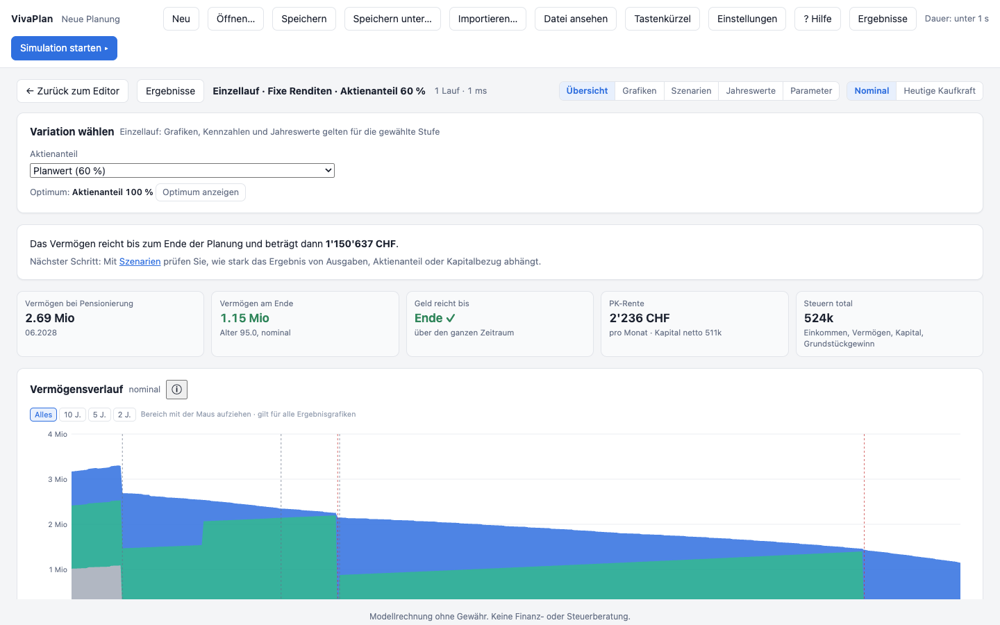

<h1 align="center">VivaPlan</h1>

<p align="center">
  <b>Reicht das Geld – und wie sicher ist das?</b><br>
  Pensionsplanung für die Schweiz. Monat für Monat, tausende Börsenverläufe, alles auf Ihrem Rechner.
</p>

<p align="center">
  <a href="LICENSE"></a>
  
  <a href="https://github.com/ingen63/VivaPlan/actions/workflows/test-quality.yml"></a>
</p>

<p align="center">
  
</p>

<p align="center">
  
</p>

<p align="center"><sub>Bildschirmfotos der mitgelieferten Beispielplanung (erfundene Daten).</sub></p>

## Worum es geht

VivaPlan rechnet Ihre finanzielle Zukunft vom heutigen Tag bis zum Ende der Planung durch, mit den Schweizer
Eigenheiten: AHV, Pensionskasse mit Umwandlungssatz und Kapitalbezug, Säule 3a, Einkommens-, Vermögens-,
Kapitalbezugs- und Grundstückgewinnsteuer, SARON-Hypotheken und die Tragbarkeitsrechnung der Banken.

Weil niemand die Börse kennt, rechnet VivaPlan nicht einen Verlauf, sondern tausende: jeden historischen Startmonat
oder Monte-Carlo-Pfade. Am Ende steht eine klare Zahl, in wie vielen Fällen das Geld reicht, und der schlechteste
Fall daneben.

## Was VivaPlan kann

- 🧮 **Monat für Monat:** Einkommen, Vorsorge, Steuern, Immobilien und Hypotheken in einer Rechnung
- 📈 **120 Jahre Börsengeschichte:** Welt (11 Länder, 1900–2020), Schweiz, S&P 500 seit 1872, alles in CHF
- 🎲 **Monte Carlo:** Bootstrap aus historischen Blöcken oder ein Aktienmodell mit Kurssprüngen; 50 000 Pfade in
  wenigen Sekunden, gleiche Einstellungen ergeben immer gleiche Ergebnisse
- 🪜 **Sechs Entnahmestrategien:** Standard, 3-Topf (wahlweise mit Guardrails), fixe Entnahmerate, Guardrails
  (Guyton-Klinger), VPW, Endowment
- 🎯 **Optimierung:** sucht die Strategie mit dem höchsten und gleichmässigsten Konsum bei begrenztem Ruinrisiko und
  übernimmt sie mit einem Klick
- 🏠 **Immobilien:** Kauf, Verkauf, Wechsel vom Haus in eine Wohnung, Notverkauf, Grundstückgewinnsteuer
- 👫 **Zwei Personen:** eigene Pensionskasse und AHV, Ehepaar-Regeln bei AHV und Steuern
- 🔀 **Szenarien:** «Was, wenn ich mit 63 gehe und die Hälfte als Kapital beziehe?» als Kurven und Heatmaps
- 🕰️ **Was wäre gewesen:** «Wie wäre es mir ergangen, wenn ich 1973 pensioniert worden wäre?»
- 🗂️ **Simulationen vergleichen:** jede Simulation wird mit der Planung von damals gespeichert
- ❓ **Hilfe auf F1:** zum Feld, an dem Sie gerade arbeiten, dazu ein Handbuch mit Suche
- 🌐 **Deutsch und Englisch:** Oberfläche, Menüs und Meldungen in beiden Sprachen (Wahl unter *Ansicht → Sprache*);
  Zahlen immer im Schweizer Format. Die Hilfe ist vorerst deutsch.

Die ausführliche Beschreibung steht in [docs/BESCHREIBUNG.md](docs/BESCHREIBUNG.md).

## Ihre Daten bleiben bei Ihnen

Kein Konto, keine Cloud, kein Tracking: VivaPlan greift nie aufs Netzwerk zu. Eine Planung ist eine einzelne Datei
(`.vplan`), die Sie speichern, kopieren und archivieren wie jedes andere Dokument.

## Installation

Pakete für macOS (.dmg), Windows (.msi, .exe) und Linux (.deb, .rpm, .AppImage) stehen unter
[Releases](https://github.com/ingen63/VivaPlan/releases).

Die Pakete sind nicht signiert. Beim ersten Start warnt das Betriebssystem deshalb:

- **macOS:** Die App in den Ordner «Programme» ziehen und öffnen. Erscheint die Meldung, dass sie nicht geöffnet werden
  kann, unter *Systemeinstellungen → Datenschutz & Sicherheit* auf «Dennoch öffnen» klicken.
- **Windows:** Im blauen Fenster «Der Computer wurde durch Windows geschützt» auf «Weitere Informationen» und dann
  «Trotzdem ausführen» klicken.
- **Linux:** Die AppImage-Datei ausführbar machen (`chmod +x VivaPlan*.AppImage`) oder das .deb- bzw. .rpm-Paket
  installieren.

## Erste Schritte

1. VivaPlan starten: Der Willkommensdialog bietet die Beispielplanung, eine eigene oder eine leere Planung an.
2. Die Checkliste «Erste Schritte» führt durch die acht Schritte des Schnellstarts und hakt Erledigtes selbst ab.
3. Simulation starten: Die Übersicht sagt in Worten, wie sicher der Plan ist, und schlägt den nächsten Schritt vor.

> **Hinweis:** VivaPlan ist ein Rechenwerkzeug und keine Anlage-, Steuer- oder Vorsorgeberatung. Vergangene
> Renditen sind keine Prognose.

## Daten und Quellen

Die Renditen stammen aus der Jordà-Schularick-Taylor Macrohistory Database (CC BY-NC-SA 4.0), den Daten von
Robert J. Shiller, der Schweizerischen Nationalbank und dem Bundesamt für Statistik. Sie fallen nicht unter die
Lizenz des Programms. Bedingungen und Zitate stehen in [QUELLEN.md](crates/engine/data/QUELLEN.md). Wegen der
JST-Lizenz bleibt VivaPlan kostenlos.

## Entwicklung

Rust-Workspace mit Rechenkern (`crates/engine`), Kommandozeile (`crates/cli`) und Desktop-App (Tauri 2,
`crates/app`, Oberfläche in HTML/JS ohne externe Bibliotheken). Über 600 Rust-Tests, Oberflächentests mit Playwright,
Abdeckung von mindestens 80 % je Paket, Mutationstests und Fuzzing.

- Aufbau, Bauen, Kommandozeile, Projektdatei und Rechenregeln: [docs/ENTWICKLUNG.md](docs/ENTWICKLUNG.md)
- Teststrategie: [docs/TESTS.md](docs/TESTS.md)

```sh
cargo build --release
target/release/vivaplan run crates/engine/assets/beispiel.vplan --events
make test        # alle Rust-Tests mit nextest (nicht cargo test; Grund in docs/TESTS.md)
```

Fehler und Wünsche gern als [Issue](https://github.com/ingen63/VivaPlan/issues).

## Lizenz

Programmcode: [GPL v3](LICENSE). Die mitgelieferten Zeitreihen fallen nicht darunter; die Rechte an den Grunddaten
liegen bei den Quellen (Robert J. Shiller, SNB, Bundesamt für Statistik, Jordà-Schularick-Taylor), siehe
[QUELLEN.md](crates/engine/data/QUELLEN.md).
